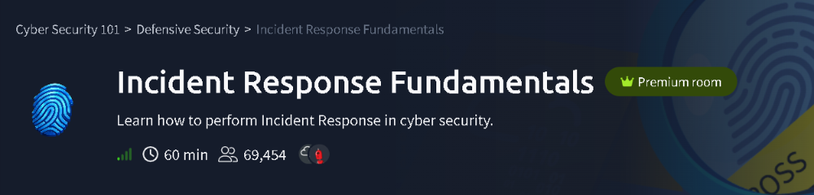
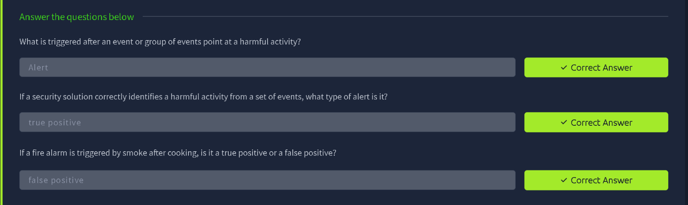
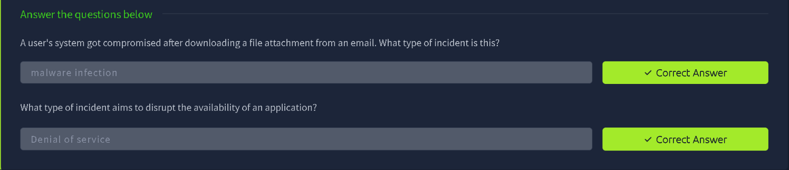
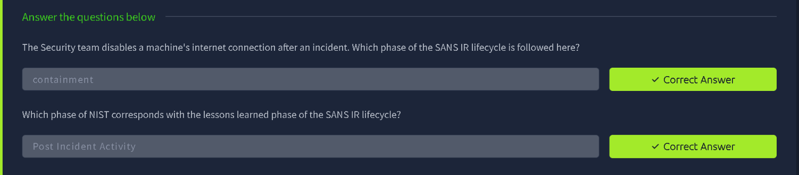
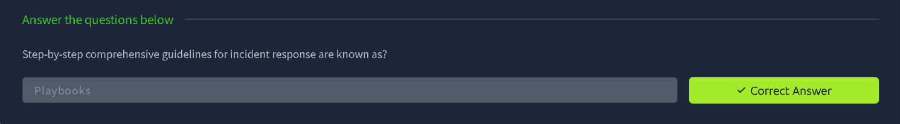
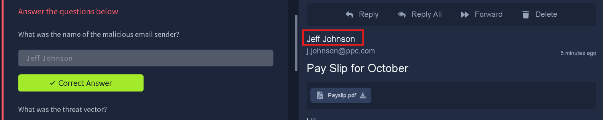
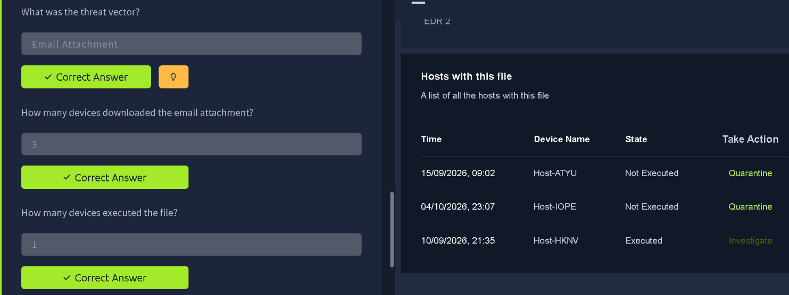
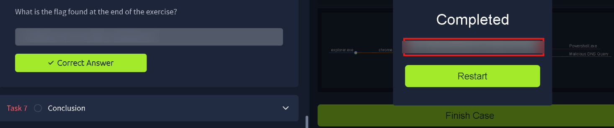

# TryHackMe: Incident Response Fundamentals

> **Track:** Cyber Security 101 → Defensive Security
> **Difficulty:** Easy · **Time:** ~60 min
> **Focus:** Incident response (IR) concepts, the SANS and NIST lifecycles, playbooks, and a hands-on triage of a phishing-driven malware incident

---

## Summary

This room walks through what happens **after** a detection fires: how an event becomes an alert, how incidents are categorised, which phases an IR team moves through, and how playbooks keep the response consistent. It ends with a simulated case where you play the analyst, tracing a malicious email to the hosts it reached.

There is no command-line work in this room. The "tools" are an email client and an EDR-style console inside the room's simulation, so this writeup covers the **analysis workflow and reasoning** instead of shell commands.

| Phase | What I did |
|---|---|
| Concepts | Alerts, true and false positives |
| Concepts | Incident types, IR lifecycle, playbooks |
| Hands-on | Identify the malicious sender in the mailbox |
| Hands-on | Confirm the threat vector and scope the blast radius in the EDR console |
| Hands-on | Finish the case and capture the flag |

---

## Task 2: Events, Alerts and the True/False Positive Question

**Core idea:** An *event* is any observable occurrence on a system. An *alert* is what a security tool raises when an event, or a group of events, points to possible harmful activity.

Once an alert fires, the analyst's first job is to classify it:

- **True positive:** the tool correctly flagged real malicious activity.
- **False positive:** the tool flagged something harmless (the room's analogy is a fire alarm set off by cooking smoke).

**Takeaway:** Triage is about deciding quickly whether an alert deserves an incident. Too many false positives cause alert fatigue; missing true positives is how breaches go unnoticed.

---

## Task 3: Types of Incidents

Incidents are grouped by the **outcome the attacker is after**, which helps decide who to involve and what to do first.

Two examples from the room:

- A user downloads an email attachment and the system is compromised → a **malware infection**.
- An attack that targets the *availability* of an application → a **denial of service**.

**Takeaway:** Mapping a situation to an incident type is the first step in choosing the right playbook.

---

## Task 4: The IR Lifecycle (SANS vs NIST)

The room compares two widely used frameworks:

| SANS (6 phases) | NIST (4 phases) |
|---|---|
| Preparation | Preparation |
| Identification | Detection and Analysis |
| Containment | Containment, Eradication and Recovery |
| Eradication | ↑ |
| Recovery | ↑ |
| Lessons Learned | Post-Incident Activity |

Two ideas the questions test:

1. **Containment** is about stopping the spread, for example cutting a compromised machine off from the network. This is the SANS phase that matches the action in the question.
2. The SANS **Lessons Learned** phase maps to NIST's **Post-Incident Activity**, where the team reviews what happened and improves for next time.

**Takeaway:** The frameworks use different names and groupings, but the flow is the same: prepare, detect, contain, remove, recover, learn.

---

## Task 5: Playbooks

Step-by-step, comprehensive guidelines for responding to a specific kind of incident are called **playbooks**. They remove guesswork under pressure and make sure every analyst handles, say, a phishing case the same way.

**Takeaway:** Playbooks turn the lifecycle into concrete, repeatable actions for each incident type.

---

## Task 6: Practical Case (Phishing → Malware)

This is the hands-on part. The scenario is a suspicious email that reached users, and the goal is to answer who sent it, how it got in, and how far it spread.

### Step 1: Identify the malicious sender (mailbox)

I opened the flagged message in the mailbox. It was a payroll-themed lure: subject *"Pay Slip for October"* with a `Payslip.pdf` attachment, a classic urgency-and-curiosity pretext.

The sender's display name is the answer to the first question.

**What to look for in a lure like this:**
- Unexpected, finance- or HR-themed subject
- An attachment the recipient did not ask for
- A generic greeting
- A sender or domain that doesn't line up with the supposed context

### Step 2: Confirm the threat vector

The question here is *how* the threat reached the environment. A malicious file arriving inside an email is an **email attachment** vector.

### Step 3: Scope the impact in the EDR console

Next I switched to the endpoint console and opened the **"Hosts with this file"** view, which lists every device that has the malicious file along with its state:

| Time | Device | State | Suggested action |
|---|---|---|---|
| 15/09/2026, 09:02 | Host-ATYU | Not Executed | Quarantine |
| 04/10/2026, 23:07 | Host-IOPE | Not Executed | Quarantine |
| 10/09/2026, 21:35 | Host-HKNV | **Executed** | **Investigate** |

**Reading the table:**
- **3 devices** received/downloaded the attachment.
- **1 device** actually executed it, which makes it the real incident.
- The two hosts where the file never ran only need **quarantine** (remove the file before anyone opens it).
- The executed host needs a full **investigation**: process tree, network connections, persistence, and so on.

This is the prioritisation habit that matters in IR: contain the cheap, safe cases fast, and spend analyst time on the host that is genuinely compromised.

### Step 4: Finish the case

With the hosts triaged, I completed the case. The simulation then displays the completion banner and the room flag. The process tree on screen shows the chain from the browser into a PowerShell process and a malicious DNS query, which is a good illustration of what the executed host's investigation would surface.

> 🔒 The flag is intentionally blurred. Complete the case yourself to see it.

---

## Key Takeaways

1. **Event → alert → classification.** Decide true vs false positive first.
2. **Name the incident type** so you can pick the right playbook.
3. **Follow a lifecycle** (SANS or NIST) so containment, eradication and recovery don't get skipped.
4. **Scope before you act.** Separate hosts that merely *have* the file from hosts that *ran* it.
5. **Close the loop** with a lessons-learned review so the next incident goes faster.

## Skills Practised

`Incident Response` · `Alert Triage` · `Phishing Analysis` · `SANS / NIST IR Lifecycles` · `Playbooks` · `Endpoint (EDR) Scoping`

---

*Room: [Incident Response Fundamentals](https://tryhackme.com/room/incidentresponsefundamentals) on TryHackMe.*
